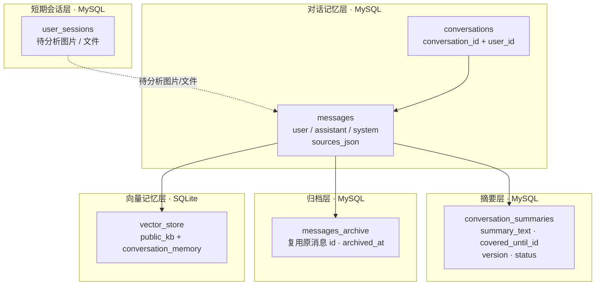
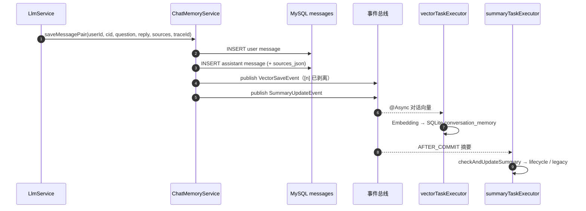
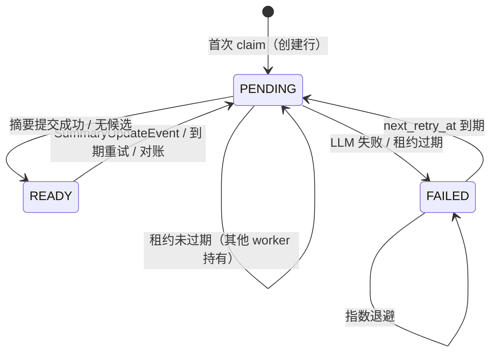

# 记忆与上下文模块总览

> 生成日期：2026-11-03
> 代码范围：`chat/` 下的 `ChatMemoryService`、`DatabaseChatMemoryRepository`、`SummaryLifecycleService`、`MessageLifecycleScheduler`、`RagContextService`、`ContextCompressionService`、`VectorStoreService`，以及 `ai/AiController`、`chat/LlmService`、`user_sessions` 相关服务。
> 配套图：
> - 模块总览：[图片/记忆上下文-模块总览-2026-11-03.svg](图片/记忆上下文-模块总览-2026-11-03.svg)
> - 摘要生命周期：[图片/记忆上下文-摘要生命周期-2026-11-03.svg](图片/记忆上下文-摘要生命周期-2026-11-03.svg)
> - 浏览器查看版：[记忆上下文模块图-2026-11-03.html](记忆上下文模块图-2026-11-03.html)

---

## 1. 模块边界

这个模块负责回答三个问题：

1. **这一轮对话要带哪些历史给模型？** —— 对话记忆、窗口截断、摘要、RAG 上下文。
2. **历史怎么长期保存、压缩、归档和清理？** —— `conversation_summaries`、`messages_archive`、生命周期调度器。
3. **历史里的知识来源怎么可追溯？** —— `sources_json`、`[n]` 引用、来源列表、历史回放。

它**不包含**业务档案本身（宠物/植物档案、护理记录、社区帖子等），但会把这些业务数据作为 Prompt 上下文使用。

一句话：

> **MySQL 保存「可回放的事实」，SQLite 保存「可检索的语义记忆」，Prompt 只带「摘要 + 最近窗口 + RAG 片段」。**

---

## 2. 记忆分层与数据结构



### 2.1 表 / 数据结构

| 结构 | 存储 | 关键字段 | 说明 |
| --- | --- | --- | --- |
| `user_sessions` | MySQL | `user_id`、`pending_image_base64`、`image_analyzed`、`pending_file_url`、`file_analyzed` | 短期工具上下文：等待分析的图片/文件；不是长期对话记忆 |
| `conversations` | MySQL | `conversation_id`、`user_id`、`created_at`、`updated_at` | 会话归属；`conversation_id` 由 Session 生成 |
| `messages` | MySQL | `id`、`conversation_id`、`role`、`content`、`timestamp`、`sources_json` | active 消息；`sources_json` 只写在 assistant 行 |
| `conversation_summaries` | MySQL | `conversation_id`、`summary_text`、`covered_until_id`、`version`、`status`、`attempt_count`、`last_attempt_at`、`next_retry_at` | 每个会话一条增量摘要状态 |
| `messages_archive` | MySQL | 复用 `messages.id`、`archived_at`、`sources_json` | 被摘要覆盖并从 active 移出的消息 |
| `vector_store` | SQLite | `document_id`、`content`、`vector`、`user_id`、`conversation_id`、`source_id` | 公共知识 + 对话记忆；向量为二进制大端 float[] |

### 2.2 三种记忆的职责

| 记忆 | 写入 | 读取 | 生命周期 |
| --- | --- | --- | --- |
| 短期会话 | 上传图片/文件时写 `user_sessions` | 工具调用前取待分析内容 | 清空会话时删除 |
| 对话记忆 | 每轮 `saveMessagePair` 写 `messages` | `buildPromptMessages` 读取 active 消息 | 摘要覆盖后归档；180 天清理 |
| 向量记忆 | 异步 `VectorSaveEvent` → Embedding → SQLite | RAG 检索时按 userId + conversationId 取 | 90 天保留；重复清理 |

---

## 3. 写入路径：一轮对话怎么落库



关键点：

- **先写 MySQL，再发事件**：消息落库是主事实；向量和摘要失败不影响回答。
- **assistant 行才写 `sources_json`**：user 行和 system 摘要行为 `NULL`。
- **引用标记剥离**：`CitationMarkers.strip()` 在进入 Prompt、摘要和向量前去掉 `[n]`，避免上一轮编号污染下一轮。
- **流式只在 `[DONE]` 后保存**：`LlmService.chatStream` 在完整流结束后才 `saveMessagePair`；流中断时部分回复不落库。
- **摘要事件是 `AFTER_COMMIT`**：`@TransactionalEventListener(phase = AFTER_COMMIT)`，避免事务未提交就触发摘要。
- **异步线程池**：`vectorTaskExecutor`（2~4 线程，队列 100）、`summaryTaskExecutor`（1~2 线程，队列 50），互不阻塞。

---

## 4. 读取路径：Prompt 怎么组装

入口：`ChatMemoryService.buildPromptMessages(userId, conversationId, systemPrompt, ragContext, userMessage)`。

```text
1. 归属校验：conversation.user_id 必须等于当前 userId
2. 读取 active messages（按 id 升序；包含 system 摘要镜像行）
3. 读取摘要：
   a. 优先 conversation_summaries.summary_text
   b. 没有时回退 messages 中 role=system 且以【对话摘要】开头的镜像行
4. 过滤：丢弃所有非摘要的 system 消息
5. 组装唯一 system 消息：
   业务规则 / 系统提示词
   → RAG 上下文（公共知识 + 相关历史对话）
   → 对话摘要
6. 追加当前 user 问题
7. 截断：
   - 保留 system 消息在首位
   - 非 system 消息按时间顺序保留最近部分
   - 条数上限 chat.memory.max-messages=10
   - token 上限 chat.memory.max-tokens=2000
8. 发送给 LLM
```

### 4.1 截断规则

| 规则 | 默认值 | 行为 |
| --- | --- | --- |
| `chat.memory.max-messages` | 10 | 非 system 消息最多保留 10 条 |
| `chat.memory.max-tokens` | 2000 | 估算 token 超过 2000 时从最旧消息开始删除 |
| `chat.memory.summary-threshold` | 3000 | 历史总 token 超过 3000 且消息数 > `keep-recent*2` 时触发摘要 |
| `chat.memory.summary-keep-recent` | 5 | 摘要保留最近 `5*2=10` 条对话不压缩 |

> **token 是估算值**：`ChatMessage.getTokenCount()` 按「中文 1.5 / 其他字符 1.3」估算，不是模型真实 tokenizer。阈值用于控制成本，不追求精确。

### 4.2 system 消息顺序

测试 `ChatMemoryServiceTest.mergesBusinessRulesRagAndSummaryIntoOneSystemMessage` 明确锁定顺序：

```text
业务规则 / 系统提示词
  → RAG 上下文
  → 对话摘要
```

三段合并为**一条 system 消息**，避免多 system 消息导致不同模型行为不一致。

### 4.3 读路径的兜底摘要

如果 `app.message-lifecycle.enabled=false` 且没有已持久化摘要，`truncateMessages` 会在读路径**同步**生成一次滚动摘要：

- 触发条件：总 token > 3000 且非 system 消息数 > 10；
- 摘要输入：除最近 10 条以外的旧消息；
- 生成后拼到 system 消息中，再继续按 10 条 / 2000 tokens 截断。

这是旧路径的兜底，会增加当次请求延迟；开启生命周期后，摘要由异步任务生成，读路径通常直接命中 `conversation_summaries`。

---

## 5. 摘要生命周期

### 5.1 两套摘要路径

| | 传统路径（默认） | 生命周期路径（开关开启） |
| --- | --- | --- |
| 开关 | `app.message-lifecycle.enabled=false` | `app.message-lifecycle.enabled=true` |
| 触发 | 每轮 `SummaryUpdateEvent` → `checkAndUpdateSummary` | 同上，但转交 `SummaryLifecycleService` |
| 摘要存储 | `messages` 中的 system 镜像行 | `conversation_summaries` + system 镜像行 |
| 旧消息 | **不删除**，只做 Prompt 截断 | 归档到 `messages_archive` 并从 `messages` 删除 |
| 并发控制 | 生成后重新计数，变化则跳过 | `covered_until_id` + `version` CAS + `PENDING` 租约 |
| 失败重试 | 无 | 10 分钟调度 + 指数退避 |
| 归档清理 | 无 | 180 天清理 |
| 旧摘要迁移 | 不迁移 | 启动时迁移到 `conversation_summaries`，水位线置 0 |

> 当前生产默认关闭生命周期，所以「摘要会生成，但旧消息不会归档/删除」。这也是为什么需要关注 `messages` 表的增长。

### 5.2 生命周期状态机



| 状态 | 含义 |
| --- | --- |
| `READY` | 当前摘要可用；`covered_until_id` 表示已覆盖到哪条消息 |
| `PENDING` | 某个 worker 持有租约，正在生成摘要 |
| `FAILED` | 生成失败；`next_retry_at` 控制下次重试时间 |

### 5.3 一次摘要的执行步骤

```text
1. 无锁预检
   active = messages WHERE role IN (user, assistant) AND id > covered_until_id ORDER BY id
   若 active.size() <= window（window = keep-recent * 2 = 10）→ 直接返回
   若 compact 窗口里没有 assistant → 返回，避免拆散一轮

2. claim（短事务）
   SELECT ... FOR UPDATE
   若 PENDING 且租约未过期 → 返回 busy
   若 FAILED 且 next_retry_at 未到 → 返回退避
   否则 status=PENDING, attempt_count++, last_attempt_at=now, version++

3. LLM 调用（事务外）
   prompt = 旧摘要 + 水位线之后、最近窗口之前的对话
   要求：保留核心事实、用户意图、未完成任务、关键数字和时间；不重复旧摘要；只输出摘要正文

4. apply（一个事务）
   version CAS 校验
   activeCount >= candidateCount 校验（防止并发删除）
   messages → messages_archive（id <= newWatermark）
   删除 messages 中 id <= newWatermark
   conversation_summaries.markReady（CAS）
   写入 system 镜像行【对话摘要】（兼容旧链路）
   任一步失败整体回滚

5. 失败
   markFailed + 指数退避：
   30s * 2^(attempt-1)，上限 21600s，最多 10 次
```

### 5.4 水位线与「不拆一轮」

- 水位线 `covered_until_id` 落在 **compact 窗口内最后一个 assistant 消息**上。
- 如果 compact 窗口末尾是 user 消息（还没等到 assistant 回复），这条 user 消息不会被摘要覆盖，留到下一轮。
- 这样不会出现「摘要里有用户问题，但没有对应回答」的断裂。

### 5.5 后台调度

| 任务 | 频率 | 行为 |
| --- | --- | --- |
| `retrySummaries` | 每 10 分钟 | 释放过期 PENDING；提交到期的 FAILED 重试；对账丢失事件 |
| `cleanupArchive` | 每天 03:40 | 删除 `archived_at < now - 180d` 的归档消息，批量 1000，最多 10 批 |
| `LegacySummaryMigration` | 启动时 | 把旧 system 摘要镜像行迁移到 `conversation_summaries`，`covered_until_id=0`，保留镜像行 |
| `MessageLifecycleSchemaMigration` | 启动时 | 兜底检查 `messages(conversation_id, id)` 索引 |

对账查询 `findReconciliationCandidates` 的逻辑：

- active 中 `id > covered_until_id` 的 user/assistant 消息数 > window；
- 摘要行不存在，或不是 PENDING，或 FAILED 且已到重试时间；
- 说明事件可能丢失，调度器补一次 `checkAndUpdateSummary`。

### 5.6 旧摘要迁移

`LegacySummaryMigration` 只在 `app.message-lifecycle.enabled=true` 时执行：

- 只处理每个会话最新一条 `【对话摘要】` system 行；
- 写入 `conversation_summaries`，`covered_until_id=0`、`status=READY`；
- **保留旧 system 镜像行**，保证旧 `AgentService` 仍能读取；
- 首次新生命周期压缩时，旧镜像行会随 `id <= watermark` 一起归档。

---

## 6. 历史回放与清空

### 6.1 历史回放

入口：`GET /api/ai/chat/history?limit=50&beforeId=...`

- `conversationId` **只从 Session 取**，客户端不能指定，避免越权。
- 只返回 `user` / `assistant`，system 摘要不展示。
- 合并查询 active 与 archive：

```sql
SELECT ... FROM messages WHERE conversation_id = ? AND role IN ('user','assistant') AND id < ?
UNION ALL
SELECT ... FROM messages_archive WHERE conversation_id = ? AND role IN ('user','assistant') AND id < ?
ORDER BY id DESC LIMIT ?
```

- 结果反转为 id 升序返回；`nextBeforeId` 作为继续向前翻页的排他游标。
- `sources_json` 随 assistant 消息返回，前端可还原来源列表。
- 响应带 `Cache-Control: no-store`。

### 6.2 清空会话

入口：`POST /api/ai/chat/clear`

```text
1. 校验 userId + conversationId 归属
2. 锁 conversation_summaries 行（与正在提交的摘要事务串行化）
3. 删除 messages
4. 删除 messages_archive
5. 删除 conversation_summaries
6. 清空 SQLite 对话向量
7. 清空 user_sessions
8. 从 HttpSession 移除 conversationId
```

清空向量时会在 `clearedConversationKeys` 中标记该会话，阻止「清空后仍在飞行中的异步向量写入」把旧数据写回来。

---

## 7. 向量记忆

### 7.1 对话向量怎么写

`VectorStoreService.saveMessage(userId, conversationId, userMessage, assistantReply)`：

- 内容：`"用户: " + userMessage + "\n助手: " + assistantReply`
- `documentId = SHA256(长度前缀(userId) + 长度前缀(conversationId) + 长度前缀(userMessage) + 长度前缀(assistantReply))`
- 写入 `user_id`、`conversation_id`，用于隔离
- 先查 `documentId` 是否已存在；并发重复插入由唯一约束兜底
- Embedding 为空则跳过
- 向量以二进制大端 float[] 存入 SQLite

### 7.2 可见性规则

`VectorStoreService.isVisible`：

1. **公共知识**（有 `source_id` 且没有 `conversation_id`）对所有用户可见；
2. **对话记忆**必须同时满足：
   - 当前请求带 `userId`；
   - 当前请求带 `conversationId`；
   - `entry.conversationId == conversationId`；
   - `entry.userId == userId`；
3. 未携带用户身份时，**只能读公共知识**，不能读对话记忆。

### 7.3 检索与 top-k

- 默认混合检索：向量通道 + 关键词通道 → 合并 → `top-k=5`。
- 重排开启时：
  - 公共知识池重排取 `top-k=5`；
  - 对话记忆单独预留 `memory-top-k=2`；
  - 重排候选池默认 20，少于 3 条不重排；
  - 重排失败回退到旧的混合余弦 top-k。
- 公共知识与对话记忆在 Prompt 中分段：
  - 「公共知识库信息」可引用 `[n]`；
  - 「相关历史对话」仅供理解上下文，**不可引用**。

### 7.4 保留与治理

| 数据 | 保留 | 开关 |
| --- | --- | --- |
| 对话向量 | 90 天 | `app.data-governance.enabled=false`（默认关闭） |
| 检索日志 | 180 天 | 同上 |
| 观测访问日志 | 180 天 | 同上 |
| 重复对话向量 | 每天 04:00 清理 | 同上 |
| 归档消息 | 180 天 | `app.message-lifecycle.enabled`（默认关闭） |

> 注意：`app.data-governance.enabled` 和 `app.message-lifecycle.enabled` 是两个独立开关，不要混用。

---

## 8. 上下文压缩与引用

### 8.1 RAG 上下文格式

`RagContextService` 把检索结果分成两段：

```text
公共知识库信息（以下编号可在回答中引用）：
[1] 浇水与积水
浇水上篇……
[2] 土壤与缺铁
缺铁表现……

相关历史对话（仅供理解上下文，不可引用）：
- 用户: 我的宠物叫豆豆
- 助手: 记住了
```

引用模式（`includeCitations=true`）下：

- 公共知识按 `SourceRef.rank` 编号；
- 历史对话明确标记为不可引用；
- 无 `sourceId` 的公共块不进入来源列表；
- 旧客户端不传 `includeCitations` 时保持旧的 chunk 编号格式。

### 8.2 上下文压缩

`ContextCompressionService` 是**确定性抽取式**压缩，默认关闭：

- 只压缩公共知识块，对话记忆逐字保留；
- 首句、含数字/时间/剂量/单位的句子、含安全关键词的句子强制保留；
- 在预算内按 query 词面重叠挑选可选句；
- 输出必须是原文句子的精确子序列；
- 任何异常、预算超限或不划算都回退原文，绝不抛到回答链路；
- 支持 canary 用户，默认 `enabled=false`。

### 8.3 引用标记的生命周期

```text
LLM 输出 "……[1]"
  → 保存到 messages.content（保留 [1]，供前端展示）
  → 保存 sources_json（来源快照）
  → 进入下一轮 Prompt 前：CitationMarkers.strip() 去掉 [1]
  → 进入摘要前：strip()
  → 进入对话向量前：strip()
```

这样 `[n]` 只属于「当前回答的展示层」，不会污染后续记忆。

---

## 9. 配置与开关

| 配置 | 默认 | 作用 |
| --- | --- | --- |
| `chat.memory.max-messages` | `10` | Prompt 中非 system 消息条数上限 |
| `chat.memory.max-tokens` | `2000` | Prompt 估算 token 上限 |
| `chat.memory.summary-threshold` | `3000` | 触发摘要的历史总 token 阈值 |
| `chat.memory.summary-keep-recent` | `5` | 摘要保留最近 `5*2=10` 条对话 |
| `app.message-lifecycle.enabled` | `false` | 摘要生命周期 + 归档 + 重试总开关 |
| `app.message-lifecycle.archive-retention-days` | `180` | 归档保留天数 |
| `app.message-lifecycle.summary-lock-ttl-seconds` | `600` | 摘要租约 TTL |
| `app.message-lifecycle.summary-max-attempts` | `10` | 摘要最大尝试次数 |
| `app.message-lifecycle.summary-retry-base-delay-seconds` | `30` | 退避基数 |
| `app.message-lifecycle.summary-retry-max-delay-seconds` | `21600` | 退避上限（6 小时） |
| `app.message-lifecycle.summary-retry-cron` | `0 */10 * * * *` | 重试/对账频率 |
| `chat.vectorstore.conversation-retention-days` | `90` | 对话向量保留天数 |
| `app.data-governance.enabled` | `false` | 向量/日志治理总开关 |
| `chat.rag.compression.enabled` | `false` | 上下文压缩开关 |
| `chat.citations.enabled` | `true` | 内联引用全局开关 |

---

## 10. 关键不变量

1. **归属双重校验**：所有读写都要 `userId + conversationId`；未确认归属的 NULL 会话默认不可读写。
2. **一条会话一个摘要行**：`conversation_summaries` 以 `conversation_id` 为主键。
3. **水位线只前进**：`covered_until_id` 只增不减；摘要覆盖到哪里，归档/删除就到哪里。
4. **CAS + 租约**：`version` 乐观锁 + `PENDING` 租约，防止多 worker 同时写摘要。
5. **摘要不拆轮**：水位线落在最后一个 assistant；末尾 user 消息留到下一轮。
6. **摘要提交原子性**：归档、删除、摘要更新、镜像行写入在同一事务；任一步失败整体回滚。
7. **引用标记不进入记忆**：`[n]` 在 Prompt、摘要、向量前剥离，只在 MySQL 正文和前端展示中保留。
8. **公共知识与对话记忆隔离**：公共知识全局可见；对话记忆只在同用户同会话可见；未登录只读公共知识。
9. **清空与异步写入竞态**：清空时标记 `clearedConversationKeys`，阻止飞行中的旧向量写回。
10. **失败不阻塞回答**：向量写入、摘要、引用审计失败都只记日志，不影响主回答。

---

## 11. 已知边界与注意事项

- **默认不归档**：`app.message-lifecycle.enabled=false` 时，摘要只写 system 镜像行，旧 `messages` 不删除；长会话下 `messages` 会持续增长。
- **读路径可能同步生成摘要**：生命周期关闭且没有持久化摘要时，`truncateMessages` 会同步调用 LLM 生成滚动摘要，可能增加首 token 延迟。
- **token 是估算**：`1.5 / 1.3` 的估算与真实 tokenizer 有偏差，阈值附近可能提前或推迟触发。
- **`getMessages` 返回全部 active 消息**：归属校验后按 id 升序全量读取，再由 `buildPromptMessages` 截断；生命周期开启后 active 集合会被压缩，关闭时没有上限。
- **SQLite 单连接池**：`Hikari maxPoolSize=1`，向量写入是串行化的；高并发写入时可能成为瓶颈。
- **摘要镜像行会重复存储**：`conversation_summaries.summary_text` 与 `messages` 中的 system 镜像行同时存在；新链路优先读摘要表，旧链路读镜像行。
- **`UserSessionService` 不是长期记忆**：它只保存待分析图片/文件，清空会话时一并删除。
- **清空会话是硬删除**：`messages`、`messages_archive`、`conversation_summaries`、对话向量、`user_sessions` 都会删除，不可恢复。

---

## 12. 测试覆盖

| 测试类 | 覆盖点 |
| --- | --- |
| `ChatMemoryServiceTest` | 会话隔离、用户隔离、system 消息合并顺序、摘要表优先、旧镜像行回退、截断、事件发布 |
| `DatabaseChatMemoryRepositoryTest` | 归属校验、越权拒绝、sources_json、历史分页、active + archive 合并、清空 |
| `SummaryLifecycleServiceTest` | 旧摘要 + 新对话、窗口不足跳过、无 assistant 不 claim、失败退避、CAS 冲突不记失败 |
| `MessageLifecycleSchedulerTest` | 关闭时零副作用、归档批量清理、重试与对账去重 |
| `LegacySummaryMigrationTest` | 迁移最新旧摘要、不覆盖已有摘要、关闭时不动 |
| `LlmServiceStreamingMemoryTest` | 流式历史注入、`[DONE]` 后保存、部分回复不保存、RAG 与摘要共存、引用模式、trace/sources 时序 |
| `RagContextServiceTest` | 公共知识与对话记忆分段、来源去重与 rank、引用模式、压缩后 rank 保持 |
| `ContextCompressionServiceTest` | 保护句、预算回退、只压缩公共块、缓存、canary、异常安全 |
| `ChatMemorySchemaIntegrationTest` | 建表/索引/摘要行与消息表的集成行为 |
| `SourceRefCodecTest` / `CitationMarkersTest` | sources_json 编解码、脏数据容错、`[n]` 剥离 |

---

## 13. 图示

| 文件 | 内容 |
| --- | --- |
| [图片/记忆上下文-模块总览-2026-11-03.svg](图片/记忆上下文-模块总览-2026-11-03.svg) | 记忆分层 + 写入路径 + 读取路径 + 关键不变量 |
| [图片/记忆上下文-模块总览-2026-11-03.png](图片/记忆上下文-模块总览-2026-11-03.png) | 同上，PNG 预览版 |
| [图片/记忆上下文-摘要生命周期-2026-11-03.svg](图片/记忆上下文-摘要生命周期-2026-11-03.svg) | 摘要状态机 + 提交事务 + 调度与重试 + legacy/lifecycle 对比 |
| [图片/记忆上下文-摘要生命周期-2026-11-03.png](图片/记忆上下文-摘要生命周期-2026-11-03.png) | 同上，PNG 预览版 |
| [记忆上下文模块图-2026-11-03.html](记忆上下文模块图-2026-11-03.html) | 浏览器查看版 |
