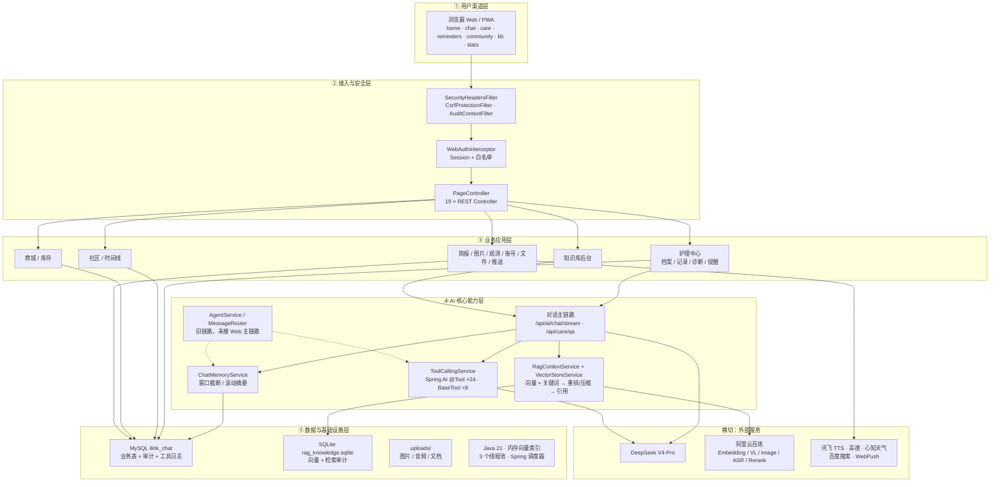

# Sekai PetPlant 项目框架总览

> 生成日期：2026-11-03
> 遍历范围：`src/main`、`src/test`、`TEST/`、`deploy/`、`scripts/`、`.github/`、`README.md`、`application.properties`
> 配套图：
> - 总体分层框架：[图片/项目框架总览-2026-11-03.svg](图片/项目框架总览-2026-11-03.svg)
> - AI 对话与 RAG 数据流：[图片/项目框架-AI链路-2026-11-03.svg](图片/项目框架-AI链路-2026-11-03.svg)
> - 浏览器查看版：[项目框架图-2026-11-03.html](项目框架图-2026-11-03.html)

---

## 1. 一句话定位

面向宠物主人与植物养护人群的 **AI 护理平台**：以 Web 为唯一入口，把「对话问诊、拍照识别、护理提醒、附近服务、成长记录」收敛到一个 AI 助手里。技术底座是 **Java 21 + Spring Boot 4.1.2 + Spring AI 2.0.2**，采用「静态前端 + REST/SSE 后端 + MySQL 业务库 + SQLite 向量库」的单体架构。

### 技术栈速览

| 分类 | 选型 |
| --- | --- |
| 语言 / 框架 | Java 21 · Spring Boot 4.1.2 · Spring MVC · Spring AI 2.0.2 |
| 前端 | 纯静态 HTML/CSS/JS（无构建链）· SSE · PWA Service Worker |
| 业务数据 | MySQL 8 `ilink_chat` · Spring Data JPA + JdbcTemplate |
| 向量数据 | SQLite `rag_knowledge.sqlite` · 内存向量索引 · Hikari 单连接池 |
| 对话模型 | DeepSeek V4-Pro（OpenAI 兼容接口） |
| 多模态 | 阿里云百炼：`text-embedding-v2`、`qwen-vl-plus`、`qwen-image-2.0`、`fun-asr-realtime`、`gte-rerank-v2` |
| 其他外部服务 | 讯飞 TTS · 心知天气 · 高德地图 · 百度搜索 · WebPush |
| 构建 / 部署 | Maven · GitHub Actions · Nginx 限流 · systemd · systemd backup timer |

---

## 2. 总体框架

项目可以概括为 **5 个纵向层 + 2 个横切面**：



### 各层职责

| 层 | 职责 | 关键实现 |
| --- | --- | --- |
| ① 用户渠道层 | 浏览器单入口；登录前落地页、登录后工作台、对话/护理/提醒/社区/知识库/观测 | `static/*.html`、`js/common.js`、`js/push.js`、`service-worker.js` |
| ② 接入与安全层 | 安全响应头、CSRF/Origin 校验、审计上下文、Session 鉴权、CORS 白名单、页面转发、REST 分发 | `SecurityHeadersFilter`、`CsrfProtectionFilter`、`AuditContextFilter`、`WebAuthInterceptor`、`WebConfig`、`PageController` |
| ③ 业务应用层 | 护理、档案、诊断、提醒、社区、商城、库存、简报、图片、观测、账号、文件、推送、知识库 | 19 个 `@RestController` + 对应 Service/Repository |
| ④ AI 核心能力层 | 流式对话、护理问答、工具调用、记忆、摘要、RAG 检索、引用与来源 | `AiController`、`LlmService`、`ToolCallingService`、`ChatMemoryService`、`RagContextService`、`VectorStoreService` |
| ⑤ 数据与基础设施层 | 业务数据、向量数据、文件、运行时线程/调度 | MySQL、SQLite、`uploads/`、`AsyncConfig`、`@Scheduled` |
| 横切：外部服务 | 模型、多模态、语音、天气、地图、搜索、浏览器推送 | 环境变量注入的 API Key + 各 Service 封装 |
| 横切：治理 | 鉴权、CSRF、安全头、审计、敏感词、RAG 可观测、灰度开关 | `config/`、`audit/`、`chat/RagObservabilityService`、`FeatureRollout` |

---

## 3. 模块地图

```text
src/main/java/com/example/demo/
├── ai/                 # Web AI 对话层：AiController、LlmService 调用、ToolCallingService、23 个 @Tool
├── chat/               # 对话记忆、摘要、RAG 检索、向量库、引用、数据治理、可观测
├── kb/                 # 知识库后台：上传、解析、分块、向量化、删除
├── agent/              # 旧自研 Agent 引擎：8 个 BaseTool，未接入 Web 主链路
├── router/             # 旧意图路由：未接入 Web 主链路
├── care/               # 护理记录、护理提醒、识图诊断、护理问答、分诊、附近服务
├── aicare/             # 宠物 / 植物档案（/api/pet、/api/plant）
├── disease/            # 植物病虫害 / 宠物皮肤病识别
├── gallery/            # 图片中心（媒体资产）
├── imagegen/           # 阿里云图像生成
├── vision/             # 阿里云视觉分析
├── asr/                # DashScope 语音识别（录音 → 文字）
├── tts/                # 讯飞语音合成
├── community/          # 社区：帖子、评论、点赞
├── timeline/           # 成长时间线
├── ebusiness/          # 商城：商品 / 分类
├── inventory/          # 库存管理
├── briefing/           # 每日简报
├── push/               # WebPush 订阅与推送
├── stats/              # 数据观测：tool_call_logs 统计
├── auth/               # 注册 / 登录 / 登出 / 登录限流
├── weather/            # 心知天气 + WeatherService @Tool
├── service/            # 高德地图等外部服务封装
├── audit/              # 操作审计：过滤器、异步写入、保留清理
├── config/             # 安全过滤器、鉴权拦截器、外部服务配置
├── core/               # WebConfig、文件上传/解析/校验、上传路径
├── utils/              # JSON 工具
└── web/                # PageController 页面路由
```

### 前端页面现状（阶段 5.1 后）

| 页面 | 入口 | 状态 |
| --- | --- | --- |
| 落地页 / 登录 / 注册 | `index.html`、`/login`、`/register` | 保留 |
| 工作台 | `/home` | 保留，作为统一 Hub |
| AI 对话 | `/chat` | 保留 |
| 护理中心 | `/care` | 保留；合并成长记录与素材入口 |
| 护理提醒 | `/reminders` | 保留；合并简报入口 |
| 社区 | `/community.html` | 保留 |
| 知识库 | `/kb` | 保留 |
| 数据观测 | `/stats` | 保留 |
| 病害 / 图片 / 简报 / 商城 / 库存 / 时间线等 7 个页面 | 已下线 | 后端模块与接口仍在，前端入口已移除 |

> 注意：**前端入口下线不等于后端删除**。`DiseaseController`、`GalleryController`、`BriefingController`、`ProductController`、`InventoryController`、`TimelineController` 仍在 `src/main/java` 中，测试也仍覆盖；当前只是没有页面导航入口。

---

## 4. 核心链路

### 4.1 正式流式对话（主链路）

入口：`POST /api/ai/chat/stream`（SSE，`SseEmitter` 120 秒）

1. `WebAuthInterceptor` 校验 Session，`AiController` 从 Session 取 `user` 与 `conversationId`（没有则创建）。
2. `LlmService.chatStream()` 编排：
   - 天气意图命中时，先用 `WeatherTool` 取实时数据并注入系统提示词；
   - `RagContextService.buildContextWithTrace()` 执行检索；
   - `ChatMemoryService.buildPromptMessages()` 组装「摘要 + 最近窗口 + RAG 上下文 + 当前问题」；
   - 以 `stream=true` 调用 DeepSeek `POST /chat/completions`；
   - 逐 token 通过 SSE 回传。
3. SSE 事件：
   - 默认事件：文本增量（打字机效果）；
   - `rag-trace`：检索 traceId；
   - `rag-stats`：命中数、耗时、通道、阈值等（请求带 `includeTraceStats`）；
   - `rag-sources`：可展示来源列表（请求带 `includeSources` 或 `includeCitations`）。
4. 流结束后 `saveMessagePair()` 写入 MySQL；有来源时同时写 `sources_json` 与 traceId。
5. 发布 `VectorSaveEvent` / `SummaryUpdateEvent`，异步写对话向量与更新摘要。

### 4.2 护理问答

入口：`POST /api/care/qa`

- 校验宠物/植物档案归属（`ownsTarget`）；
- 读取档案与护理记录，拼入系统提示词；
- 调用 `LlmService.chatWithMemory()`，走同一套「记忆 + RAG」契约；
- 返回 `reply`、`targetName`、`species`、`sources`；
- 支持 `includeCitations`，正文内联 `[n]` 与来源列表。

### 4.3 工具调用

入口：`POST /api/ai/chat-with-tools`

- `ToolCallingService` 通过反射扫描 `@Tool`，注册 **24 个工具**（`SpringAiTools` 23 个 + `WeatherService` 1 个），按 8 组生成默认系统提示词；
- 最多 **5 轮** function calling，工具在固定线程池执行；
- 每次调用写入 `tool_call_logs`（工具名、参数摘要、耗时、成功/失败），供 `/api/stats` 统计；
- 该入口是**单轮兼容模式**，不自动读写持久化多轮记忆；
- 旧 `AgentService` + 8 个 `BaseTool` + `MessageRouter` 保留用于历史追溯，**未接入 Web 主链路**。

### 4.4 RAG 检索管线

```text
用户问题
  ├─ 向量通道：Embedding → 余弦相似度，阈值 0.45
  ├─ 关键词通道：IDF 加权限定，floor 0.45（仅公共知识）
  ├─ 可见性：公共知识全局可见；会话记忆校验 userId + conversationId
  ├─ 合并去重 → 可选重排（gte-rerank-v2，候选池 20，最少 3 条，canary）
  ├─ 可选压缩（extractive，默认关闭，保护安全句）
  ├─ 来源去重 → SourceRef[]（sourceId + title + rank）
  └─ 组装 [n] 引用上下文 → LLM
```

相关配置（`application.properties`）：

| 配置 | 默认值 |
| --- | --- |
| `chat.vectorstore.top-k` | `5` |
| `chat.vectorstore.similarity-threshold` | `0.45` |
| `chat.vectorstore.keyword-floor` | `0.45` |
| `chat.vectorstore.rerank.enabled` | `false`（按 `canary-users` 灰度） |
| `chat.rag.compression.enabled` | `false` |
| `chat.vectorstore.memory-top-k` | `2` |

### 4.5 记忆 / 摘要 / 生命周期

- 会话与消息存 MySQL；读取时按「最近 10 条 / 2000 tokens」窗口截断；
- 超过摘要阈值（3000）后异步生成滚动摘要，保留最近 5 条；
- `app.message-lifecycle.enabled=false` 时，归档清理与摘要重试不执行；
- 摘要失败有重试、租约锁、陈旧锁释放与对账任务；
- 归档保留 180 天；对话向量保留 90 天；检索日志保留 180 天。

### 4.6 知识库导入

```text
上传文件（txt / md / json / csv / log / pdf / docx）
  → FileParserService 解析（大小、页数、字符数、并发、超时保护）
  → KnowledgeImportService 分块（CHUNK_LENGTH=500，上限 2000）
  → EmbeddingService 批量向量化（批大小 10，重试 3 次）
  → VectorStoreService.replaceDocument() 事务化替换
  → SQLite vector_store + 内存索引
```

知识库写操作默认关闭（`app.kb.writes-enabled=false`），开启后仅 `admin-users` 可写。

### 4.7 后台任务

| 任务 | 频率 | 说明 |
| --- | --- | --- |
| 护理提醒扫描 | 60 秒 | 到期提醒 → WebPush |
| 每日简报 | 每天 08:00 | 生成简报并推送 |
| 库存巡检 | 6 小时 | 低库存预警 |
| 摘要重试 / 对账 | 每 10 分钟 | 失败摘要重试、丢失事件对账 |
| 归档清理 | 每天 03:40 | 180 天前消息归档清理 |
| 社区孤儿向量清理 | 每天 03:30 | 删除无主帖子向量 |
| 重复向量清理 | 每天 04:00 | 对话向量去重 |
| 对话向量保留清理 | 每天 04:15 | 90 天前对话向量 |
| RAG 日志保留清理 | 每天 04:30 | 检索/观测日志 180 天 |
| 审计日志清理 | 每天 04:45 | 操作审计 365 天 |

---

## 5. 数据与存储

| 存储 | 内容 | 关键点 |
| --- | --- | --- |
| MySQL `ilink_chat` | 用户、会话、消息、摘要、归档、宠物/植物档案、护理记录/目标/诊断历史、社区帖子/评论/点赞、商品/分类、库存、时间线、推送订阅、操作审计、`tool_call_logs` | 主数据源；JPA `ddl-auto=update` + 启动期自定义建表 |
| SQLite `rag_knowledge.sqlite` | `vector_store`、`rag_retrieval_log`、`rag_observability_access_log` | 独立数据源；Hikari `maxPoolSize=1`；启动加载到内存索引 |
| 文件系统 `uploads/` | AI 图片、TTS 音频、上传文档 | `/uploads/**` 受 `WebAuthInterceptor` 保护；UUID 文件名 |
| 本地 `knowledge/` | 知识库原始文档 | 导入来源，不参与运行时读写 |

双数据源由 `chat/config/SQLiteConfig.java` 配置：MySQL 为 `@Primary`，SQLite 独立 `EntityManagerFactory` / `TransactionManager` / `JdbcTemplate`。

---

## 6. 外部依赖

| 服务 | 用途 | 配置前缀 |
| --- | --- | --- |
| DeepSeek V4-Pro | 主对话模型（OpenAI 兼容） | `dashscope.*`、`spring.ai.openai.*` |
| 阿里云百炼 Embedding | `text-embedding-v2` 向量化 | `dashscope.embedding.*` |
| 阿里云百炼视觉 | `qwen-vl-plus` 图片分析 | `dashscope.vision.*` |
| 阿里云百炼图像 | `qwen-image-2.0` 生成/编辑 | `dashscope.image.*` |
| 阿里云百炼 ASR | `fun-asr-realtime` 语音识别 | `dashscope.asr.*` |
| 阿里云百炼 Rerank | `gte-rerank-v2` 重排 | `dashscope.rerank.*` |
| 讯飞 TTS | 语音合成 | `xunfei.tts.*` |
| 心知天气 | 实时/未来天气 | `weather.api.*` |
| 高德地图 | 附近服务、导航链接 | `amap.*` |
| 百度搜索 | 联网搜索 | `baidu.search.*` |
| WebPush | VAPID 浏览器推送 | `webpush.vapid.*` |

---

## 7. 安全与治理

- **鉴权**：Session Cookie `ILINKSESSION`，`HttpOnly`、`SameSite=Lax`，生产可开 `Secure`；`/api/**`、`/uploads/**` 除登录/注册/`me` 外均需登录。
- **请求保护**：安全响应头、CSRF/Origin/Referer 校验、CORS 显式白名单、登录失败限流。
- **上传保护**：大小、扩展名、内容校验；PDF 页数、DOCX 段落数、解析字符数、并发与超时上限。
- **数据隔离**：档案、记录、提醒、图片、会话均按 `user_id` 校验归属；会话记忆同时校验 `userId + conversationId`。
- **审计**：登录、注册、删除、发布、上传等关键操作写 `operation_audit_log`，异步落库，365 天保留。
- **RAG 可观测**：检索日志只存查询哈希、范围、阈值、命中数、耗时、命中文档标识与相似度，不落明文查询/正文；受控只读接口默认关闭。
- **灰度开关**：RAG 重排、上下文压缩、消息生命周期、知识库写入、RAG 观测均默认关闭；审计默认开启。

---

## 8. 部署、运维与质量

- **构建**：Maven，产出 Spring Boot JAR；`mvnw` 本地构建。
- **部署**：Nginx 反向代理 + 限流（`deploy/nginx/ilink-rate-limit.conf`）+ systemd 服务。
- **备份**：`ilink-backup.timer` 定时备份；`ilink-backup-check.timer` 校验；`ilink-restore-drill.timer` 恢复演练。
- **CI**：GitHub Actions `build.yml`、`dependency-scan.yml`、`secret-scan.yml`；Dependabot 配置。
- **测试**：`src/test` 46 个测试类，覆盖 AI 会话、RAG、向量库、生命周期、鉴权、CSRF、上传、审计、社区等；`TEST/` 是独立评测客户端，覆盖质量通过率、Recall@K、引用覆盖率/精确率。
- **版本基线**：Spring Boot 4.1.2 / Spring AI 2.0.2 / Java 21；旧版 Boot 3 + Spring AI 1.x 已完成迁移。

---

## 9. 现状与边界

1. **双对话路径并存**
   - 正式流式对话：`LlmService` 直接走 HTTP/SSE，便于精细控制记忆、RAG、引用与事件；
   - Spring AI 路径：`SpringAiChatService` / `ToolCallingService` 负责单轮兼容与工具调用；
   - 两者共享 `ChatMemoryService` 与 RAG 契约，但不是同一条代码路径，修改时需分别验证。
2. **旧 Agent 体系保留但不在主链路**
   - `AgentService`、`MessageRouter`、8 个 `BaseTool` 仍可编译、有历史文档，但 Web 端不调用；不要误把它们当成当前入口。
3. **前端入口已收敛**
   - 阶段 5.1 下线 7 个页面，但后端 Controller 仍在；若后续要彻底删除，需要同步清理测试、导航、文档与部署说明。
4. **灰度能力默认关闭**
   - 重排、压缩、消息生命周期、知识库写入、RAG 观测默认关闭；生产行为以环境变量和 `canary-users` 为准。
5. **单机单体架构**
   - 当前是单实例 + 本地文件 + SQLite 向量库，适合当前规模；横向扩展前需要先处理 SQLite 单连接池、本地 `uploads/`、内存向量索引与调度器重复执行问题。
6. **公开仓库安全遗留**
   - 历史提交曾包含仍在使用的第三方凭据，轮换与清理是独立的安全收尾项，详见 `落地文档/安全风险与上线检查清单.md`、`落地文档/阶段4.1凭据与暴露面自查-2026-10-23.md`。本文不展开凭据内容。

---

## 10. 图示文件

| 文件 | 内容 |
| --- | --- |
| [图片/项目框架总览-2026-11-03.svg](图片/项目框架总览-2026-11-03.svg) | 五层 + 横切的总体分层框架图（矢量） |
| [图片/项目框架总览-2026-11-03.png](图片/项目框架总览-2026-11-03.png) | 总体框架图 PNG 预览版，可直接插入 PPT |
| [图片/项目框架-AI链路-2026-11-03.svg](图片/项目框架-AI链路-2026-11-03.svg) | `/api/ai/chat/stream` 的检索、记忆、生成、回写与异步链路（矢量） |
| [图片/项目框架-AI链路-2026-11-03.png](图片/项目框架-AI链路-2026-11-03.png) | AI 链路图 PNG 预览版 |
| [项目框架图-2026-11-03.html](项目框架图-2026-11-03.html) | 浏览器查看版，内嵌两张图与速览卡片 |
